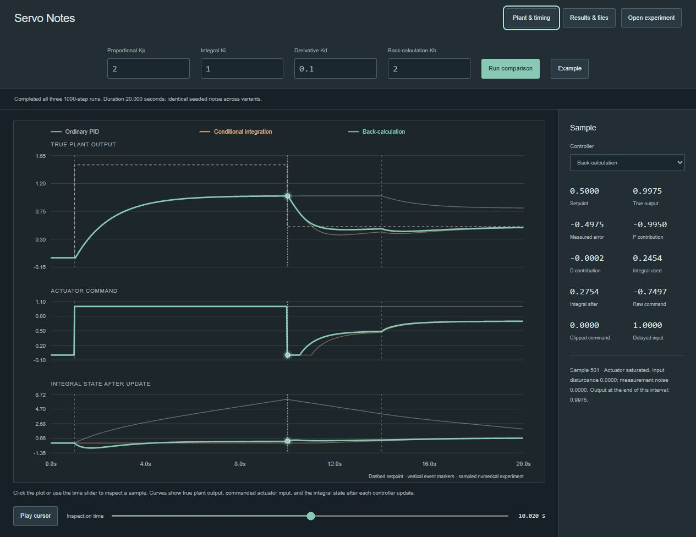

# Servo Notes

A sampled-control experiment comparing ordinary PID, conditional integration, and back-calculation anti-windup. Inspect saturation, delayed commands, disturbances, and recovery with reproducible numerical traces.



## Interface

Three aligned plots share a time cursor, with the selected controller sample beside them. Gain inputs remain above the plots; plant configuration, run metrics, and exports open separately. The chart keeps its original aspect ratio so pointer inspection stays aligned with the time axis, and scrolls within its panel on narrow screens.

The selected controller is emphasized in all three plots. Glowing sample markers show its output, command, and integral values at the inspection time; markers disappear outside a partial run’s valid prefix. SVG exports retain the selected traces and markers. New comparisons fade in briefly unless reduced motion is requested.

## Run

Requires Python 3.10+; no runtime dependencies or build step.

```sh
python run.py --port 8000
```

Open http://127.0.0.1:8000. Computation runs in a browser worker; the loopback server exposes only application assets. No hardware access, telemetry, external fonts, or data upload.

## Features

- Compare true plant output, clipped command, and integral state for three controller variants.
- Tune Kp, Ki, Kd, and Kb directly; edit plant dynamics, event timing, limits, delay, and noise in JSON.
- Inspect any sample by clicking the plot or using a keyboard-accessible slider; animate the inspection cursor.
- Inspect proportional and derivative contributions, integral state before/after correction, raw/clipped commands, and delayed plant input.
- Compare total/recovery integrated absolute error, RMSE, saturation counts, peak integral, and final tracking error.
- Export complete evidence, every sample as CSV, the standalone SVG chart, and portable experiment inputs.
- Retain valid prefixes and explicit failure reasons if controller arithmetic exceeds the numerical bound.

The [example](docs/example.json) uses an unreachable 1.5 setpoint with a maximum command of 1, then returns to 0.5 at 10 seconds. A −0.2 input disturbance begins at 14 seconds. Over the 20-second run, recovery IAE is approximately 4.0926 for ordinary PID, 0.9180 for conditional integration, and 0.6186 for back-calculation. These results describe this experiment, not a universal ranking. An [exported chart](docs/example-chart.svg) is included.

## Explicit discrete model

The plant obeys `dy/dt = (−y + gain × (applied + disturbance)) / tau`. For one sample interval, with `a = exp(−dt/tau)`, its exact zero-order-hold update is:

```text
y_next = a*y + (1-a)*gain*(applied + disturbance)
```

At each zero-based sample k:

1. Select the setpoint: zero before stepAt, highTarget before returnAt, then returnTarget. Add the seeded noise sample to the current plant output.
2. Compute error = target − measurement. Filter the backward measurement difference with `alpha = exp(−dt/filterTau)`; derivative contribution is `D = −Kd * filtered_difference`. The first difference is initialized to zero.
3. Form `candidate = previous_integral + Ki*error*dt`, then `raw = Kp*error + candidate + D`, and clip raw to the actuator limits.
4. Ordinary PID retains candidate. Conditional integration rejects candidate if it would push farther into saturation, recomputes raw with the previous integral, and clips again. Back-calculation retains `candidate + Kb*(clipped−raw)*dt` for the next sample; the current command still uses candidate.
5. Pass the clipped command through an integer-sample delay queue initialized with clipped zero commands. Add the sustained input disturbance and advance the plant.

The derivative acts on measurement, avoiding a derivative kick caused solely by a setpoint change. All variants receive the same xorshift32 uniform noise sequence in [−noise, noise). This does not make their measurements equal, because their true outputs can differ.

Rows describe values at the beginning of an interval plus nextY at its end. Total IAE and RMSE use true tracking error at interval starts. Recovery IAE includes intervals from returnAt onward. Final output is the last completed interval's nextY. Saturation counts compare raw and clipped commands. Command variation starts from clipped zero. Metrics for interrupted runs cover only their completed prefix.

## Bounds and limitations

Experiments have 50–5,000 samples, dt 0.002–0.2 seconds, delay 0–20 samples, and nonzero 32-bit seeds. Gain is 0.1–5, tau 0.05–10, Kp/Ki/Kb 0–50, Kd 0–20, and derivative-filter tau 0.002–2. Initial output, targets, and actuator bounds are within ±10; disturbance within ±5; noise amplitude 0–1. Event indices must fit the horizon with stepAt < returnAt. Imported input files are limited to 100 KB.

Controller magnitudes above 1e9 stop only the affected run, preserving finite evidence. Large back-calculation gains relative to the sample interval can be numerically unstable. Exact plant integration does not make the sampled controller stable or accurate for arbitrary dt. This is a first-order model with explicit discrete controller conventions, not a production controller, auto-tuner, stability proof, or hardware deployment tool.

## Verification

Node.js 22+ runs the engine tests; Python checks the static server.

```sh
npm test
npm run check
python -m unittest discover -s tests -p "test_*.py"
```

Thirteen JavaScript tests cover closed-form uncontrolled decay and constant-input responses, exact sample delay, derivative behavior, conditional integration, back-calculation recurrence, zero-gain equivalence, unsaturated equivalence, default recovery behavior, shared seeded noise, metric accounting, explicit numerical stops, and validation. One Python test checks HTTP assets and server boundaries. CI runs Linux and Windows checks.

Browser verification covers controller selection, tuning, zero-Kb equivalence, partial runs, plot/keyboard inspection, playback, invalid timing, exports, and reimport. An independent Python implementation verified all 3,000 default controller/plant samples, recovery integrals, CSV values, and the ten exported SVG curves.

## Reference

The anti-windup concepts are described in MathWorks' [Anti-Windup Control Using PID Controller Block](https://www.mathworks.com/help/simulink/slref/anti-windup-control-using-a-pid-controller.html). Servo Notes implements the discrete equations documented above and does not claim numerical equivalence to that product.
